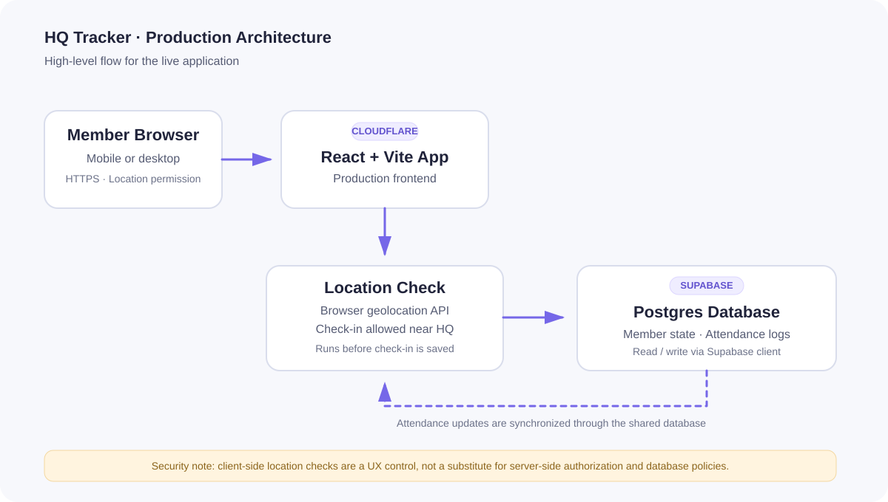

# HQ Tracker — Portfolio Demo

A portfolio presentation of an attendance-tracking system built for the Innovation & Entrepreneurship Club. The public repository contains a **separate frontend-only demo**; it is not the source code of the production deployment.

<p align="center">
  
</p>

<p align="center">
  <a href="https://hq.iecpsau.org/">Live website</a> ·
  <a href="https://github.com/Layanvii/hq-tracker">Private production source (not publicly accessible)</a>
</p>

## Demo vs. production

These are two different implementations and should not be confused:

| | Public portfolio demo | Production application |
|---|---|---|
| Purpose | Demonstrates the dashboard UI | Used for the club's attendance workflow |
| Frontend | Vanilla JavaScript, HTML, CSS | React + Vite |
| Data | Fictional data embedded in the frontend | Supabase database |
| Location check | Not implemented | Browser geolocation check before check-in |
| Deployment | Portfolio repository / demo hosting | Cloudflare deployment, linked to the live website |

## Production architecture

The live application uses **React + Vite** for its frontend, **Supabase** for persistent data, and **Cloudflare** for deployment/delivery.

### Attendance flow
1. A member selects their section and enters their name and PIN.
2. Before check-in, the browser requests location permission and checks the reported coordinates against the configured HQ radius.
3. The current implementation uses a **100-metre radius**. If the location check fails or permission is denied, check-in is stopped.
4. The application reads and updates attendance state in the `club_data` table and writes detailed check-in/check-out events to `attendance_logs`.

The location check runs on the client in the browser. It is a useful location gate, but **should not be described as tamper-proof security**. Production access controls and Supabase Row Level Security (RLS) must be reviewed independently.

## Demo features

- Attendance dashboard with overview cards and a weekly trend
- Searchable sample member list
- Sample attendance statuses and check-in times
- Responsive layout for desktop and mobile
- Fictional data only; no connection to the production database

## Screenshots

The dashboard demo is available at the live demo / repository preview. Add real screenshots here when captures from the actual interface are available; no production member data should be visible in screenshots.

## Run the demo locally

```bash
npm install
npm run dev
```

## Tech stack

**Demo:** Vite · Vanilla JavaScript · HTML · CSS

**Production:** React · Vite · Supabase · Cloudflare · Browser Geolocation API

## Privacy and security notes

- The public demo contains fictional sample data and is not intended to record real attendance.
- The production application and this demo are separate; the demo does not connect to the production Supabase project.
- Never publish Supabase service-role keys, private credentials, real member PINs, or real attendance records.
- A client-side location check does not replace server-enforced authorization and database access policies.

## Usage and impact

The system is linked as a live club website. I have not included a member count or usage statistic because I do not have a verified figure to publish. Add a confirmed number only if the club has approved sharing it publicly.
